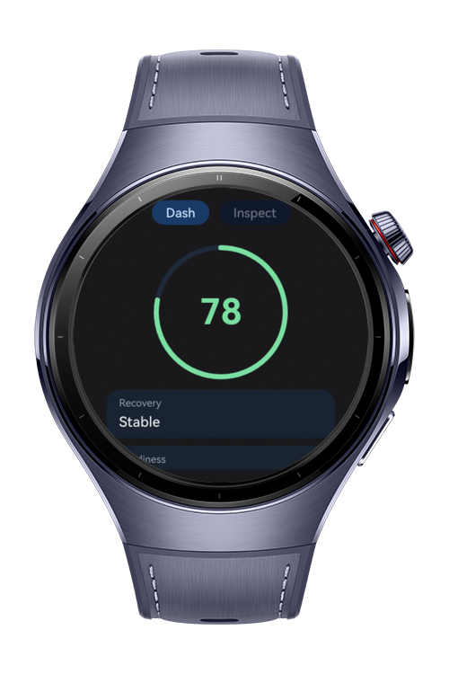
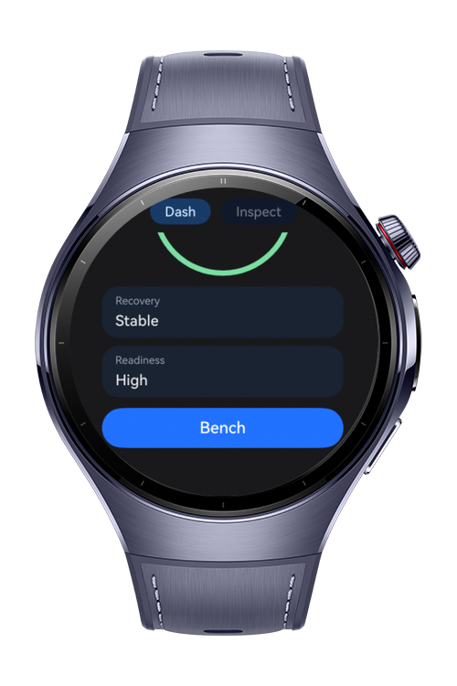
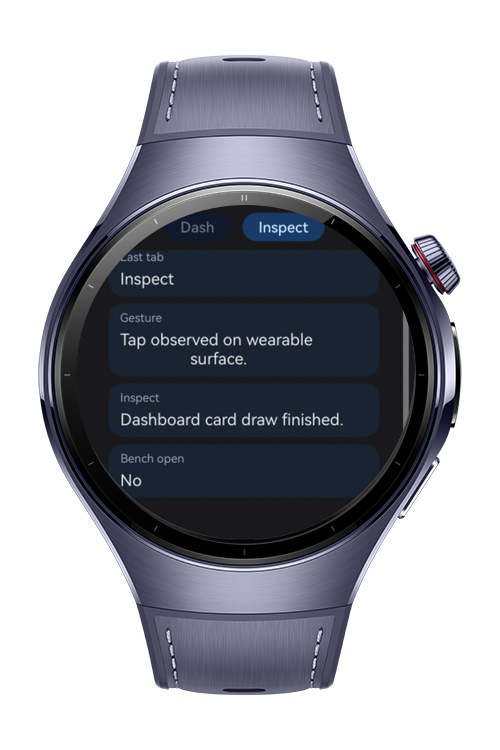

> **Note:** To access all shared projects, get information about environment setup, and view other guides, please visit [Explore-In-HMOS-Wearable Index](https://github.com/Explore-In-HMOS-Wearable/hmos-index).

# How To Build Arc Progress Dashboard

This HarmonyOS wearable sample demonstrates a compact Arc Progress Dashboard built with ArkTS and ArkUI. The app combines a circular score surface, compact metric cards, an inspect panel, component observation, attribute updates, and a lightweight bench window in one believable watch-sized workflow.

# Preview

<div>
  
  
  
</div>

# Use Cases

- Display an arc-style activity or readiness score on a round wearable screen
- Observe component layout and draw completion from the UI layer
- Track compact inspection state on-device without leaving the main flow
- Open a small bench dialog window for extra UI verification
- Validate a round-screen layout using scroll-safe content areas

# Technology

## Stack

- **Languages**: ArkTS, ArkUI
- **Frameworks**: HarmonyOS Stage Model
- **Tools**: DevEco Studio, Hvigor
- **Libraries**:
	- `@kit.ArkUI`
	- `@ohos.app.ability.UIAbility`
	- `@ohos.window`

## Required Permissions

- ohos. permission. SYSTEM_FLOAT_WINDOW

# Directory Structure

```
entry/
|   src/
|       main/
│   module.json5
│
├───ets
│   ├───entryability
│   │       EntryAbility.ets
│   │
│   ├───entrybackupability
│   │       EntryBackupAbility.ets
│   │
│   └───pages
│           Index.ets

```

# Constraints and Restrictions

## Supported Device

- Huawei Watch 5
- HarmonyOS smart wearables
- Round-screen wearable layouts are the primary target

# License
**How to Build Arc Progress Dashboard** is distributed under the terms of the MIT License. See the [LICENSE](LICENSE) for more information